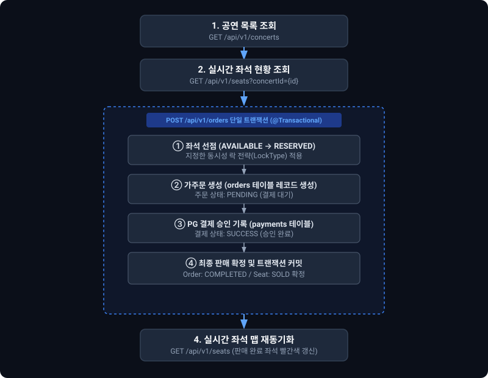
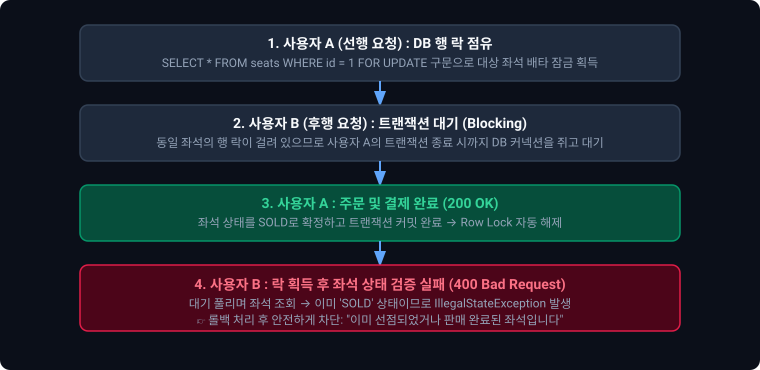
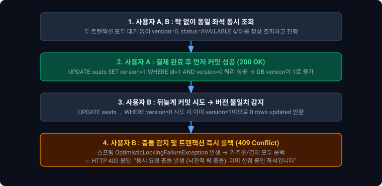
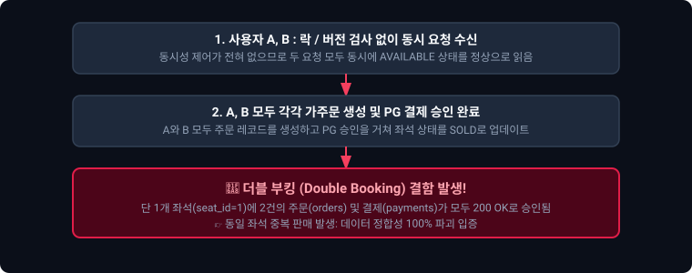

# Ticket Stream v1 - 프로세스 플로우

티켓 예매의 전체 사이클(선점 $\rightarrow$ 주문 $\rightarrow$ 결제)과 동시성 락 전략을 API 명세와 함께 한눈에 파악할 수 있도록 정리한 문서입니다.

---

## 1. 전체 예매 라이프사이클 (API 흐름)

사용자가 공연을 조회하고 좌석을 선점하여 결제까지 완료하는 전체 주기입니다.

### 단계별 상세 설명

| 단계 | 호출 API | 주요 작업 및 데이터 상태 변화 |
| :--- | :--- | :--- |
| **1. 공연 조회** | `GET /api/v1/concerts` | 예매 가능한 콘서트 목록 및 장소, 일정 확인 |
| **2. 좌석 조회** | `GET /api/v1/seats?concertId={id}` | 해당 공연의 500개 좌석 배치도 및 실시간 상태(`AVAILABLE` 등) 확인 |
| **3. 예매 사이클** | `POST /api/v1/orders` *(userId, concertId, seatId, lockType)* | **[단일 트랜잭션 원자적 처리]** • **좌석 선점**: 락 전략에 따라 동시성 검증 후 `AVAILABLE` $\rightarrow$ `RESERVED` • **주문 생성**: 가주문 레코드 생성 (`orders.status = PENDING`) • **결제 승인**: PG 결제 승인 기록 생성 (`payments.status = SUCCESS`) • **최종 확정**: 주문 완료(`COMPLETED`) 및 좌석 판매 확정(`SOLD`) |
| **4. 현황 갱신** | `GET /api/v1/seats?concertId={id}` | 예매 성공/실패 후 좌석 배치도 실시간 재동기화 |
| **(참고) 리셋** | `POST /api/v1/seats/reset/{concertId}` | 부하 테스트용: 전체 좌석 초기화(`AVAILABLE`) 및 주문/결제 내역 일괄 삭제 |

---

## 2. 동시성 락(Lock) 3가지 전략 비교

동일 좌석에 여러 명이 동시에 `POST /api/v1/orders`를 요청할 때의 동작 차이입니다.

| 구분 | 비관적 락 (`PESSIMISTIC`) | 낙관적 락 (`OPTIMISTIC`) | 락 미적용 (`NONE`) |
| :--- | :--- | :--- | :--- |
| **적용 기술** | **DB 행 배타 잠금** (`SELECT FOR UPDATE`) | **JPA 버전 검사** (`version` 컬럼) | **락 없음** (경합 시뮬레이션용) |
| **처리 방식** | 1등이 락 점유, 후행자는 **대기(줄서기)** | 동시 처리 후 **커밋 시점에 충돌 감지** | 동시 조회 및 수정 (동시 통과) |
| **결과** | **1명 성공**, 나머지 `400 Bad Request` | **1명 성공**, 나머지 `409 Conflict` | **더블 부킹 발생** (동일 좌석 2명 결제) |
| **사용 목적** | 충돌이 극심한 대규모 티켓팅에 필수 | 충돌 빈도가 낮고 락 지연을 줄일 때 | 동시성 결함/부작용 검증용 |

#### 1. 비관적 락 (`PESSIMISTIC` - 줄서기)

#### 2. 낙관적 락 (`OPTIMISTIC` - 버전 확인)

#### 3. 락 미적용 (`NONE` - 더블 부킹 결함)

---

## 3. 예외 및 응답 코드 요약

| 상황 | HTTP 상태 코드 | 반환 메시지 |
| :--- | :--- | :--- |
| **예매 성공** | `200 OK` | 좌석 예매 및 결제가 성공적으로 완료되었습니다. |
| **이미 선점/판매된 좌석** | `400 Bad Request` | 이미 선점되었거나 판매 완료된 좌석입니다. |
| **낙관적 락 버전 충돌** | `409 Conflict` | 동시 요청 충돌 발생 (낙관적 락 충돌) |
| **존재하지 않는 식별자** | `400 Bad Request` | 존재하지 않는 좌석/공연입니다. |
| **데이터 리셋 완료** | `200 OK` | 좌석 및 관련 주문/결제 내역이 모두 초기화되었습니다. |
