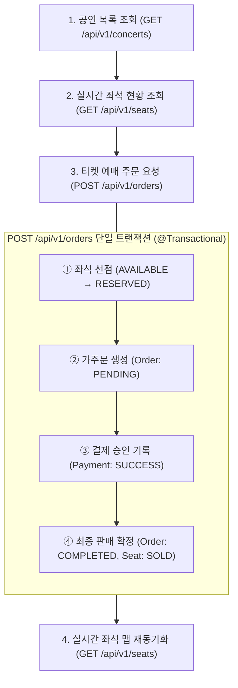
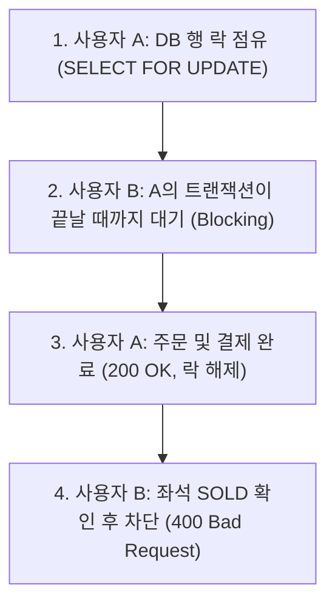
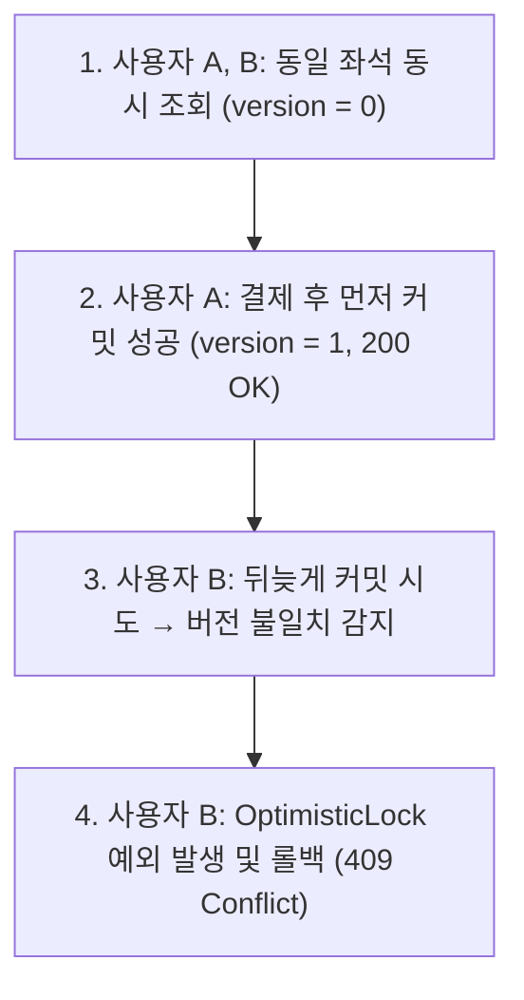
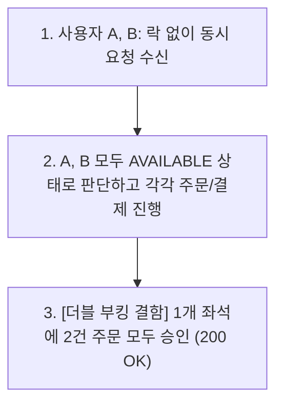

# Ticket Stream v1 🎫

단일 모놀리식 아키텍처 환경에서 대규모 티켓 예매 시 발생하는 동시성 충돌을 재현하고, **비관적 락(Pessimistic Lock)**, **낙관적 락(Optimistic Lock)**, **락 미적용(None)** 전략의 정합성과 성능 한계를 실시간 시각화 및 부하 테스트로 검증하는 프로젝트입니다.

---

## 1. 프론트, 백 설치 및 실행 방법

### 1.1 사전 요구사항 (Prerequisites)
- **Java**: 21 이상
- **Node.js**: 18.x 이상
- **Docker & Docker Compose**: PostgreSQL 컨테이너 구동용
- **k6** (선택 사항): 부하 테스트용 CLI (`C:\Program Files\k6\k6.exe` 설치됨)

---

### 1.2 실행 순서

#### Step 1. PostgreSQL DB 구동 (Docker Compose)
프로젝트 루트 디렉토리에서 DB 컨테이너를 실행합니다.
```powershell
docker-compose up -d
```
> **DB 접속 정보**: `localhost:5432` / 데이터베이스: `ticket_v1_db` / 계정: `ticket` / 암호: `1234`

#### Step 2. 백엔드(Spring Boot) 실행
새 터미널에서 Gradle Wrapper를 통해 서버를 구동합니다.
```powershell
.\gradlew.bat bootRun
```
> 서버가 정상 구동되면 `http://localhost:8080` 포트로 API 서비스가 시작됩니다.

#### Step 3. 프론트엔드(Next.js) 실행
새 터미널을 열고 `front` 디렉토리로 이동하여 의존성 설치 및 개발 서버를 실행합니다.
```powershell
cd front
npm install
npm run dev
```
> 브라우저에서 `http://localhost:3000`에 접속하여 실시간 좌석 맵 콘솔을 확인합니다.

#### Step 4. (선택) k6 부하 테스트 실행
백엔드가 켜져 있는 상태에서 터미널에 아래 명령어를 실행하여 동시성 검증을 수행합니다.
```powershell
# 비관적 락 15명 동시 요청 테스트
k6 run k6/pessimistic-lock-test.js

# 웹 대시보드 자동 오픈 실행 (실시간 모니터링)
k6 run --out web-dashboard=open=true k6/dashboard-test.js

# 테스트 완료 후 영구히 볼 수 있는 HTML 리포트 생성
k6 run --out web-dashboard=export=report.html k6/pessimistic-lock-test.js
```

---

## 2. 프로젝트 개요

대규모 티켓팅(인터파크, 멜론티켓 등) 환경에서는 수천~수만 명의 사용자가 단 1개의 좌석을 동시에 선점하려는 **극단적인 경쟁 상태(Extreme Contention)**가 발생합니다.

**Ticket Stream v1**은 단일 데이터베이스(PostgreSQL) 기반의 모놀리식 환경에서:
- 동시성 제어가 없을 때 발생하는 **더블 부킹(Double Booking, 중복 판매)** 결함을 직접 재현하고,
- **비관적 락(`SELECT FOR UPDATE`)**과 **낙관적 락(`@Version`)**의 정합성 보장 방식을 비교하며,
- 대규모 트래픽 폭주 시 단일 DB 락이 마주하는 **커넥션 풀 고갈 및 연쇄 장애 한계**를 실증하기 위해 구축되었습니다.

### 기술 스택
- **Backend**: Java 21, Spring Boot 3.4, Spring Data JPA, Hibernate
- **Database**: PostgreSQL 15, HikariCP
- **Frontend**: Next.js 14, TypeScript, Tailwind CSS
- **Load Test**: Grafana k6

---

## 3. 프로젝트 목표

1. **데이터 정합성 100% 보장**: 단 1개의 좌석에 다수의 동시 요청이 유입되어도 중복 판매가 절대 발생하지 않도록 제어.
2. **동시성 락 전략별 심층 비교**:
   - **비관적 락 (`PESSIMISTIC`)**: DB 행 배타 잠금을 통해 순차 처리하여 확실한 정합성 보장.
   - **낙관적 락 (`OPTIMISTIC`)**: 충돌 발생 시 예외 롤백을 통해 DB 락 지연 최소화.
   - **락 미적용 (`NONE`)**: 레이스 컨디션을 유도하여 동시성 결함 실증.
3. **단일 DB 락의 병목 및 한계 측정**: 100건 이상의 동시 부하 상황에서 발생하는 HikariCP 커넥션 풀 고갈과 3초 타임아웃 장애의 실증적 분석.
4. **실시간 시각화 & 원클릭 검증 환경 제공**: 프론트엔드 좌석 맵을 통해 좌석 선점 및 판매 상태를 실시간으로 모니터링.

---

## 4. API 명세서

모든 API는 `http://localhost:8080/api/v1` 베이스 경로를 사용하며 공통 응답 규격(`ApiResponse<T>`)을 반환합니다.

### 4.1 엔드포인트 목록

| 도메인 | HTTP Method | Endpoint URI | 설명 |
| :--- | :---: | :--- | :--- |
| **공연** | `GET` | `/api/v1/concerts` | 전체 공연 목록 조회 |
| **공연** | `GET` | `/api/v1/concerts/{id}` | 특정 공연 상세 정보 조회 |
| **좌석** | `GET` | `/api/v1/seats?concertId={id}` | 해당 공연의 500개 좌석 실시간 상태 조회 |
| **좌석** | `GET` | `/api/v1/seats/{id}` | 특정 좌석 단건 상세 조회 |
| **주문** | `POST` | `/api/v1/orders` | **좌석 선점 + 가주문 + 결제 승인 + 판매 확정** (단일 트랜잭션) |
| **초기화**| `POST` | `/api/v1/seats/reset/{concertId}` | 부하 테스트용 좌석(`AVAILABLE`) 및 주문/결제 내역 일괄 리셋 |

---

### 4.2 주요 API 상세 스펙

#### [POST] `/api/v1/orders` - 티켓 예매 (핵심 트랜잭션)
- **Request Body**:
  ```json
  {
    "userId": 1001,
    "concertId": 1,
    "seatId": 1,
    "lockType": "PESSIMISTIC" // PESSIMISTIC | OPTIMISTIC | NONE
  }
  ```
- **Response Body (200 OK - 성공 시)**:
  ```json
  {
    "success": true,
    "message": "주문이 완료되었습니다.",
    "data": {
      "orderId": 1,
      "seatId": 1,
      "amount": 110000,
      "status": "COMPLETED",
      "createdAt": "2026-11-17T13:00:00",
      "message": "좌석 예매 및 결제가 성공적으로 완료되었습니다."
    }
  }
  ```
- **HTTP 응답 상태 코드**:
  - `200 OK`: 예매 및 결제 성공
  - `400 Bad Request`: 이미 판매 완료된 좌석 (`IllegalStateException`) 또는 유효하지 않은 요청
  - `409 Conflict`: 낙관적 락 버전 충돌 (`OptimisticLockingFailureException`)
  - `500 Internal Server Error`: 락 대기 시간 초과(3초) 또는 DB 커넥션 풀 고갈

---

## 5. 프로세스 및 플로우 (API 명 포함)

### 5.1 전체 예매 라이프사이클 흐름



---

### 5.2 3가지 동시성 락 전략별 처리 비교

동일 좌석에 복수의 사용자가 동시에 `POST /api/v1/orders`를 호출했을 때의 동작 비교입니다.

#### 1. 비관적 락 (`PESSIMISTIC` - 줄서기 방식)
DB 행 배타 잠금(`SELECT FOR UPDATE`)을 획득한 1명만 진행되고, 나머지는 대기하다 안전하게 차단됩니다.



#### 2. 낙관적 락 (`OPTIMISTIC` - 버전 확인 방식)
락 없이 동시에 진행한 후, 커밋 시점에 `@Version` 충돌을 감지하여 1명만 성공시키고 후행자는 즉시 롤백합니다.



#### 3. 락 미적용 (`NONE` - 더블 부킹 결함 재현)
동시성 제어가 없어 동일 좌석에 중복 결제가 발생하는 레이스 컨디션을 재현합니다.



---

## 6. 프로젝트 결과

k6 부하 테스트 도구 및 웹 UI를 통해 도출된 핵심 검증 결과입니다.

### 6.1 락 전략별 검증 결과 요약

| 전략 | 15명 동시 요청 결과 | 120명 과부하 결과 | 정합성 여부 | 평가 |
| :--- | :--- | :--- | :---: | :--- |
| **락 미적용 (`NONE`)** | **2건 이상 성공 (200 OK)** | 다수 중복 결제 발생 | ❌ **파괴** | 더블 부킹 결함 재현 확인 |
| **낙관적 락 (`OPTIMISTIC`)** | **1건 성공 + 14건 409 충돌** | 1건 성공 + 다수 409 충돌 | ⭕ **유지** | 락 대기가 없어 빠르나 대량 충돌 시 롤백 비용 발생 |
| **비관적 락 (`PESSIMISTIC`)** | **1건 성공 + 14건 400 차단** | **1건 성공 + 약 80건 400 차단 + 약 39건 500 타임아웃** | ⭕ **유지** | • 정합성은 100% 보장<br/>• **과부하 시 커넥션 풀 고갈 및 3초 타임아웃 한계 확인** |

---

### 6.2 핵심 기술적 인사이트 및 향후 과제 (v2 로드맵)

1. **비관적 락의 한계 도출**:
   - 비관적 락은 데이터 정합성을 확실하게 지켜주지만, **단 1개 좌석에 100건 이상의 부하가 집중되면 3초 락 타임아웃과 HikariCP 커넥션 풀(10개)이 고갈**됩니다.
   - 이로 인해 해당 좌석과 무관한 일반 공연 조회(`GET /concerts`)까지 먹통이 되는 **연쇄 장애(Cascading Failure)**를 확인했습니다.
2. **향후 고도화 방향 (v2 아키텍처)**:
   - **Redis 원자적 연산 / 분산 락(Fast-Fail)**: DB에 요청이 도달하기 전 Redis 레벨에서 1등만 통과시키고 나머지 999명을 즉각 차단하여 DB 커넥션 낭비 방지.
   - **대기열 큐(Kafka / Redis Sorted Set)**: 대규모 트래픽을 순차적인 버퍼로 흡수하여 백엔드 DB의 부하를 일정 수준 이하로 제어.
