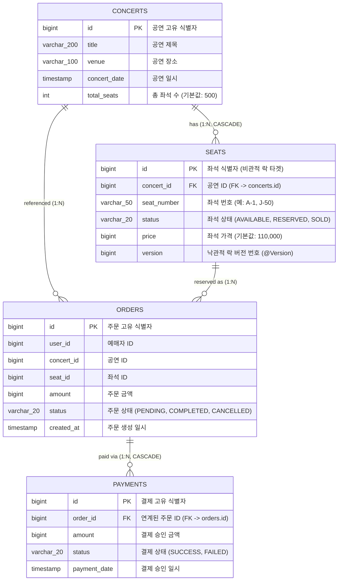

# Ticket Stream v1 - Database Schema & ERD

본 문서는 **Ticket Stream v1**의 데이터베이스(PostgreSQL) 스키마 정의 및 ERD(Entity Relationship Diagram) 명세서입니다.  
티켓 예매 시 대규모 동시성 제어(Pessimistic Lock / Optimistic Lock) 테스트를 지원하기 위한 구조로 설계되었습니다.

---

## 1. ERD (Entity Relationship Diagram)

---

## 2. 테이블 상세 명세

### 2.1 concerts (공연 마스터)
공연의 기본 정보를 저장하는 마스터 테이블입니다.

| 컬럼명 | 데이터 타입 | 제약 조건 | 기본값 | 설명 |
| :--- | :--- | :--- | :--- | :--- |
| `id` | `BIGSERIAL` | `PK`, `NOT NULL` | 자동 증가 | 공연 고유 식별자 |
| `title` | `VARCHAR(200)` | `NOT NULL` | - | 공연 제목 |
| `venue` | `VARCHAR(100)` | `NOT NULL` | - | 공연 장소 (예: 고양종합운동장) |
| `concert_date` | `TIMESTAMP` | `NOT NULL` | - | 공연 진행 일시 |
| `total_seats` | `INT` | `NOT NULL` | `500` | 총 좌석 수 |

---

### 2.2 seats (좌석 및 동시성 제어)
공연별 좌석 정보 및 동시 예매 충돌을 제어하기 위한 핵심 테이블입니다.

| 컬럼명 | 데이터 타입 | 제약 조건 | 기본값 | 설명 |
| :--- | :--- | :--- | :--- | :--- |
| `id` | `BIGSERIAL` | `PK`, `NOT NULL` | 자동 증가 | 좌석 고유 식별자 (비관적 락 `SELECT FOR UPDATE` 대상) |
| `concert_id` | `BIGINT` | `FK`, `NOT NULL` | - | 공연 ID (`concerts.id` 참조, `ON DELETE CASCADE`) |
| `seat_number` | `VARCHAR(50)` | `NOT NULL` | - | 좌석 번호 (예: `A-1`, `J-50`) |
| `status` | `VARCHAR(20)` | `NOT NULL` | `'AVAILABLE'` | 상태 (`AVAILABLE`: 선점가능, `RESERVED`: 선점중, `SOLD`: 판매완료) |
| `price` | `BIGINT` | `NOT NULL` | `110000` | 좌석 티켓 가격 |
| `version` | `BIGINT` | `NOT NULL` | `0` | 낙관적 락 충돌 검출용 버전 컬럼 (`@Version`) |

#### 인덱스 (Indexes)
- `idx_seats_concert_status`: `(concert_id, status)` - 공연별 예매 가능 좌석 고속 조회
- `idx_seats_concert_number`: `(concert_id, seat_number)` - 특정 좌석 지정 조회 성능 향상

---

### 2.3 orders (예매 주문)
사용자의 좌석 선점 및 주문 내역을 저장하는 테이블입니다.

| 컬럼명 | 데이터 타입 | 제약 조건 | 기본값 | 설명 |
| :--- | :--- | :--- | :--- | :--- |
| `id` | `BIGSERIAL` | `PK`, `NOT NULL` | 자동 증가 | 주문 고유 식별자 |
| `user_id` | `BIGINT` | `NOT NULL` | - | 예매 사용자 식별자 |
| `concert_id` | `BIGINT` | `NOT NULL` | - | 예매한 공연 ID |
| `seat_id` | `BIGINT` | `NOT NULL` | - | 선점한 좌석 ID |
| `amount` | `BIGINT` | `NOT NULL` | - | 결제 대상 주문 금액 |
| `status` | `VARCHAR(20)` | `NOT NULL` | `'PENDING'` | 주문 상태 (`PENDING`: 결제대기, `COMPLETED`: 완료, `CANCELLED`: 취소) |
| `created_at` | `TIMESTAMP` | `NOT NULL` | `CURRENT_TIMESTAMP` | 주문 생성 일시 |

#### 인덱스 (Indexes)
- `idx_orders_user`: `(user_id)` - 사용자별 주문 목록 조회
- `idx_orders_seat`: `(seat_id)` - 좌석별 활성 주문 조회

---

### 2.4 payments (결제 승인 이력)
주문에 대한 PG 결제 시도 및 승인 결과를 기록하는 테이블입니다.

| 컬럼명 | 데이터 타입 | 제약 조건 | 기본값 | 설명 |
| :--- | :--- | :--- | :--- | :--- |
| `id` | `BIGSERIAL` | `PK`, `NOT NULL` | 자동 증가 | 결제 고유 식별자 |
| `order_id` | `BIGINT` | `FK`, `NOT NULL` | - | 연계된 주문 ID (`orders.id` 참조, `ON DELETE CASCADE`) |
| `amount` | `BIGINT` | `NOT NULL` | - | 결제 승인 금액 |
| `status` | `VARCHAR(20)` | `NOT NULL` | `'SUCCESS'` | 결제 상태 (`SUCCESS`: 승인 성공, `FAILED`: 실패) |
| `payment_date` | `TIMESTAMP` | `NOT NULL` | `CURRENT_TIMESTAMP` | 결제 승인 일시 |

#### 인덱스 (Indexes)
- `idx_payments_order`: `(order_id)` - 주문별 결제 이력 조회

---

## 3. 관계(Relationship) 명세

1. **`concerts` - `seats` (1:N)**
   - 외래키: `seats.concert_id` $\rightarrow$ `concerts.id` (`ON DELETE CASCADE`)
   - 한 공연은 여러 개의 좌석을 가집니다. 공연 데이터 삭제 시 하위 좌석도 함께 삭제됩니다.
2. **`concerts` - `orders` (1:N)**
   - 논리적 외래키: `orders.concert_id` $\rightarrow$ `concerts.id`
   - 주문이 어떤 공연에 대한 것인지 기록합니다.
3. **`seats` - `orders` (1:N)**
   - 논리적 외래키: `orders.seat_id` $\rightarrow$ `seats.id`
   - 한 좌석에 대해 시간 흐름에 따라 취소/재예매 등으로 여러 건의 주문 이력이 쌓일 수 있습니다.
4. **`orders` - `payments` (1:N)**
   - 외래키: `payments.order_id` $\rightarrow$ `orders.id` (`ON DELETE CASCADE`)
   - 한 주문 건에 대한 결제 승인/시도 내역을 관리합니다.

---

## 4. 동시성 제어 및 핵심 비즈니스 로직

1. **좌석 상태 전이 (State Machine)**
   - `AVAILABLE` (선점 가능) $\rightarrow$ `RESERVED` (주문 생성 및 선점 중) $\rightarrow$ `SOLD` (결제 완료 및 판매 확정)
   - 결제 실패 또는 주문 만료 시: `RESERVED` $\rightarrow$ `AVAILABLE` (롤백)

2. **동시성 락 전략**
   - **비관적 락 (Pessimistic Lock)**: `seats.id`를 기준으로 `SELECT ... FOR UPDATE` 구문을 통해 DB Row Lock을 획득하여 동일 좌석 중복 선점을 원천 차단.
   - **낙관적 락 (Optimistic Lock)**: `seats.version` 컬럼을 활용하여 별도 DB 락 대기 없이 커밋 시점의 버전 충돌 감지(`ObjectOptimisticLockingFailureException`)로 롤백 처리.
